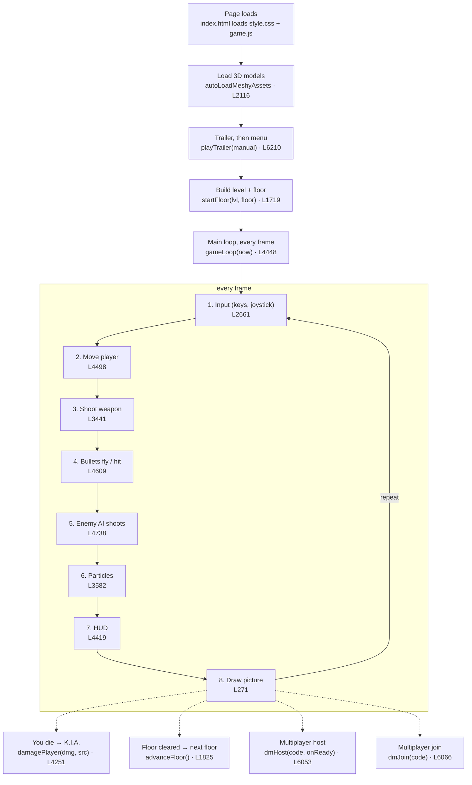

# DYSTOPIA: what you can change, and where

Search with Ctrl+F using the `snippet`. Tags: easy / medium / risky.

## Flow chart

## Try these 5 first

- **Walk speed**: `game.js` line 85, now 14, safe 8 – 22. Find: `walkSpeed: 14`
- **Pulse Cannon fire rate**: `game.js` line 89, now 0.13 s between shots, safe 0.05 – 0.4. Find: `fireRate: 0.13, spread: 0.008`
- **Fog thickness**: `game.js` line 251, now 0.0075, safe 0 – 0.03. Find: `scene.fog = new THREE.FogExp2(0x07090d, 0.0075)`
- **Debris chunk size**: `game.js` line 3571, now 0.06 – 0.22, safe 0.02 – 0.3. Find: `const sz = (0.06 + Math.random() * 0.16)`
- **Bullet color**: `game.js` line 90, now 0xffaa00 (orange), safe any 0xRRGGBB. Find: `color: 0xffaa00, speed: 88`

## New quick wins

- **Main sun light casts shadow**: `game.js` line 317. Find: `dirLight.castShadow = true;`
- **Player lantern (around you)**: `game.js` line 284. Find: `const camFill = new THREE.PointLight(0xffe2c0, 0.12, 10, 1.6);`
- **Health pickup amount**: `game.js` line 4555. Find: `if (p.type === 'health') STATE.player.health = Math.min(100, STATE.player.health + 35);`

## Adding assets, step by step

### A1. Which folder
Put files here (lowercase names, no spaces): models/ 3D (.glb) · images/tex/ textures (.jpg/.png) · audio/ short sounds (.mp3) · music/ songs (.mp3) · media/ video (.mp4) · fonts/ (.woff2).

### A2. Formats + phone budget
Use .glb (one file; .gltf needs its extra files too). Textures .jpg (photos) or .png (see-through), 1024×1024 max. Sounds .mp3 (works on iPhone; .ogg does NOT play on iPhone Safari). Budget per model: under 1.5 MB and under ~15,000 triangles. Characters up to ~25k. Shrink big ones (see the Android tutorial, A4).

### A3. Load a model: one line in the jobs list
Add a line inside const jobs = [. Format: { file: 'models/NAME.glb', role: 'prop:NAME', height: METRES },. The game resizes the model so it is exactly that tall. Copy the extinguisher line as your template:

- `game.js` line 2123: `const jobs = [`
- `game.js` line 2146: `{ file: 'models/ph_extinguisher.glb', role: 'prop:ph_extinguisher', height: 0.62 },`

### A4. Worked example: a traffic cone
1) Import cone.glb into models/. 2) Under the extinguisher line add { file: 'models/cone.glb', role: 'prop:cone', height: 0.7 }, 3) Teach the map what a "cone" is: inside PROP_BUILDERS = {, copy the extinguisher(o) { block, rename it cone(o) { and change cloneProp('ph_extinguisher') to cloneProp('cone'). 4) Place it (A5). The prop key after prop: must match the name in cloneProp.

- `game.js` line 964: `const PROP_BUILDERS = {`
- `game.js` line 1058: `  extinguisher(o) {`
- `game.js` line 946: `function cloneProp(key) {`

### A5. Place it on a floor
Placements live in genFloorLayout, one block per floor. if (floor === 0) is G, floor === 1 is B1, floor === 2 is B2, the last else is B3. Add add('cone', 2, 60, { rot: 0 }); inside a block. x = left/right (-88 to 88), z = front/back (start is near z 70 on G). rot is radians: Math.PI / 2 = 90°. Size: add h: 1.2 in the {…} for builders that read o.h, or change height in jobs.

- `game.js` line 1509: `function genFloorLayout(level, floor) {`
- `game.js` line 1512: `const add = (type, x, z, extra = {}) =>`
- `game.js` line 1535: `add('extinguisher', -3.9, 69, { rot: Math.PI / 2 });`

### A6. Swap or add a texture
Easiest: replace images/tex/metal_wall_1k.jpg with your own picture of the same name. To use a new name, edit the path in the line below. For a single material: map: new THREE.TextureLoader().load('images/tex/my.jpg') inside its MeshStandardMaterial({ … }).

- `game.js` line 380: `swap(WALL_PBR.map, 'images/tex/metal_wall_1k.jpg'`

### A7. Add a sound effect
Copy how the Mender dispatch line plays: const a = new Audio('audio/my_sound.mp3'); a.volume = 0.8; a.play().catch(() => {}); Put it where the event happens (e.g. inside firePlayerWeapon).

- `game.js` line 3258: `const a = new Audio('audio/sentinel_dispatch.mp3'); a.volume = 0.9;`
- `game.js` line 3441: `function firePlayerWeapon`

### A8. Add or swap music
Each slot in MUSIC_TRACKS is a song. Change the url: to your file in music/, and update name/by for the credits. Only use music you have the rights to (CC0/CC BY), and never your own songs in builds.

- `game.js` line 6125: `title: { url: 'music/title_rising_game.mp3'`

### A9. New enemy type
Risky, ask Grok Bot for the first one. Short version: load the model with role: 'guard'-style line in jobs, then add an entry to BOT_ROSTER (copy a line, change id, name, maxHealth, tint). Enemies on floors are spawned in startFloor from BOT_ROSTER.

- `game.js` line 30: `let BOT_ROSTER = [`
- `game.js` line 1719: `function startFloor(lvl, floor) {`

### A10. Upload the file in Spck
Spck file tree → long-press the models folder → Import / Upload file → pick from Downloads. Then Git → Changes → tick the new file + game.js → Commit with a message → Push. Live in ~1 minute.

### A11. Common mistakes
Case matters online: Cone.glb ≠ cone.glb. Works in preview, breaks live.Path is relative to index.html: models/cone.glb, never /sdcard/… or C:\.Opening index.html from the Files app (file://) blocks model loading (CORS). Use Spck preview.Forgot the comma at the end of the jobs line → black screen.Big file (10 MB+) → slow load, phone crashes. Shrink first.Model is sideways? add yaw: Math.PI / 2 to its jobs line.

## Add your own files & scripts

### M1. Make a new JS file
In Spck long-press the mods folder → New file → mymod.js. Start by copying mods/starter_mod.js (it is in the repo, tested in headless Chrome: cube spins, M toggles fog, kills print to the console).

- `mods/starter_mod.js` line 7: `const MOD_CUBE = new THREE.Mesh(`

### M2. Load it after game.js
In index.html, add your line under the game.js line. The ?v=1 is a cache-buster: bump it to ?v=2 each time you push so phones grab the new copy.

- `index.html` line 383: `<script src="game.js?v=`

### M3. Starter mod: what each part does
1) a glowing cube added to scene · 2) M toggles scene.fog · 3) wraps finishBotKill to log each kill · 4) its own requestAnimationFrame loop keeps the cube in front of you. 👀 Instant win: change 0xff00ff to 0x00ff00 and the cube turns green.

- `mods/starter_mod.js` line 21: `finishBotKill = function (b) {`
- `mods/starter_mod.js` line 27: `function modLoop() {`

### M4. Safe hook points (globals you can use)
THREE (3D library) · scene (add/remove things) · camera · renderer · STATE (player, weapons, level, floor) · STATE.player (x, y, z, yaw, health) · BOTS (enemy list) · PICKUPS · SFX (sounds) · functions you can call or wrap: startFloor(lvl, floor), finishBotKill(b), damagePlayer(dmg, src), explode(x, y, z, {scale}), addKillFeed(msg). Wrap = save the old one, replace it, call the old one inside (like M3).

- `game.js` line 83: `const STATE = {`
- `game.js` line 606: `let BOTS = [];`
- `game.js` line 3550: `function explode(x, y, z, opt = {}) {`
- `game.js` line 4267: `function addKillFeed(msg) {`

### M5. Try in the console first
Easiest experiment of all: wrap a line, e.g. explode(STATE.player.x, 1, STATE.player.z - 6, { scale: 2 }) in a mod, or in Chrome DevTools/Eruda console. Boom in front of you.

### M6. Your own CSS file
Make mymod.css and add <link rel="stylesheet" href="mymod.css?v=1"> in index.html under the style.css line. Later rules win, so #crosshair .absolute { background:lime !important; } overrides the game.

- `index.html` line 21: `<link rel="stylesheet" href="style.css?v=`

### M7. Your own level data file
Make mods/mylevel.js that changes data before you play, e.g. LEVEL_CONFIGS[1].name = 'MY LEVEL'; LEVEL_CONFIGS[1].fogColor = 0x220000;, or pushes props in a wrapped genFloorLayout (call the old one, then out.objects.push({ id: 'my-1', type: 'crate', x: 0, z: 60, w: 3, d: 3, h: 3, rot: 0, color: '#f00' }) and return it). Load it after game.js.

- `game.js` line 21: `const LEVEL_CONFIGS = (() => {`
- `game.js` line 1509: `function genFloorLayout(level, floor) {`

### M8. New HTML pages
Any .html you add is a web page at …/dystopia-project-moses/yourpage.html. Copy learn-3d-112248cf/step1.html as a template. Link to it from anywhere with <a href="yourpage.html">.

### M9. What NOT to touch
Don't rename game.js functions or top-level names (STATE, BOTS…) — other code calls them.Don't delete or rename an id="…" in index.html — game.js looks them up.Don't edit tools/ or regression-out/ from Spck.Never paste tokens or API keys into a file (the Meshy key lives only in the browser).Mods can't change const numbers inside functions — for those, edit game.js (see the tweak cards).

## Project tour

| File | What |
|---|---|
| `index.html` | The page: HUD, menus and buttons (HTML). Loads style.css then game.js. |
| `style.css` | All the looks: fonts, colours, touch button sizes. |
| `game.js` | The whole game (~6,400 lines). Map below. |
| `mods/starter_mod.js` | Example mod (not loaded until you add its script line). |
| `models/` | 3D .glb files (enemies, guns, props). |
| `images/` | Textures (images/tex/) and the title background. |
| `audio/` | Voice lines and short sounds. |
| `music/` | Kevin MacLeod songs (CC BY 4.0). |
| `media/` | Trailer video + poster + TRAILER_SOURCES.md credits. |
| `fonts/` | Black Ops One, Chakra Petch, Caveat (.woff2). |
| `icons/, manifest.webmanifest` | Home-screen app icon and install info. |
| `CREDITS.md` | Who made each asset. Add a line whenever you add one. |
| `STORY_BIBLE.md` | The lore: Moses, the Accord, the Sentinels. |
| `README.md` | Project summary. |
| `learn-3d-112248cf/` | Tutorials: step1–10, android.html, vscode.html, this page. |
| `dystopia-upgraded.html` | Old single-file version (history only, not the live game). |
| `unity-test-2f894cad/` | An old Unity experiment + Android APK. Not used by the web game. |
| `regression-out/` | Screenshots from the last test run. Safe to ignore. |
| `tools/regression.js` | Plays every level in headless Chrome and checks 264 things (bots move, doors open…). Computer + Node only, not Spck. Ask Grok Bot to run it. |
| `tools/CHECKLIST.md` | The list of what regression.js checks. |
| `tools/shots.js` | Screenshots of every screen at phone sizes. Node only. |
| `tools/peek.js` | Screenshots of chosen spots in a level. Node only. |
| `tools/trailer_capture.js` | Records trailer gameplay frame-by-frame at 30 fps. Node only. |
| `tools/mp_test.js + fakepeer.js` | Tests multiplayer with two fake players. Node only. |
| `tools/mod_test.js` | Checks the starter mod works. Node only. |
| `tools/build_tweaks.py` | Builds this page and TWEAKS.md, and checks every line number. Python only. |

### game.js sections

| Lines | Section |
|---|---|
| 18–102 | Header, settings, level data, player/weapons (STATE) |
| 103–214 | Sound synth (SFX) |
| 215–413 | Renderer, camera, lights, textures |
| 414–605 | Enemy bodies (procedural Sentinels) |
| 606–887 | World pieces (walls, lights, signs, props) |
| 888–2084 | Floor system: Colossus, floor layouts, startFloor |
| 2085–2198 | Model loading (jobs list) |
| 2199–2507 | Squad AI: nav grid, cover, A* |
| 2508–2670 | Lore notes and posters |
| 2671–2947 | Enemy weapons |
| 2948–3118 | FPS arms + viewmodel |
| 3119–3517 | Spawning, Menders, firing |
| 3518–3613 | Explosions & particles |
| 3614–3987 | Score, Colossus weak points, wreck |
| 3988–4289 | Barrels and drones |
| 4290–4757 | Controls + the main game loop |
| 4758–5211 | Studio, Meshy panel, party, startup |
| 5212–5630 | Weapons detail, offices, mobile UI |
| 5631–6123 | Cheats, skins, deathmatch multiplayer |
| 6124–6395 | Music, trailer, final UI |

### Read these first

- **updateHUD()** (line 4419): Short. Shows how numbers in STATE become text on screen.
- **firePlayerWeapon()** (line 3441): What happens when you pull the trigger: ammo, recoil, bullets.
- **explode()** (line 3550): Numbered steps 1–7: flash, fire, smoke, sparks, debris. Very readable.
- **damagePlayer()** (line 4251): Armor, health, death screen: simple if/else logic.
- **partyCode()** (line 5137): 3 lines. A loop that builds a random code. Perfect first read.
- **startFloor()** (line 1719): How a level is built and enemies are spawned.
- **gameLoop()** (line 4448): The heartbeat: runs every frame. Read the first 30 lines.

## Learning path

1. **Turbo legs**: Change walkSpeed: 14 to 30. Save, refresh. 👀 you zoom.
2. **Paint the bullets**: Pulse Cannon color: 0x38bdf8 → 0xff00ff. 👀 pink shots.
3. **Load the starter mod**: Add the script line from M2. 👀 a pink cube floats in front of you.
4. **Your first wrap**: In your mod, add addKillFeed('HELLO FROM MY MOD') inside the finishBotKill wrapper. 👀 your words in the kill feed on every kill.
5. **Read and tweak a function**: Read partyCode(), change i  to i . Host a game. 👀 a 3-letter code.

## Test
Edit one number → Ctrl+S → Spck ▶ preview (refresh) → look.

## Undo
Ctrl+Z; keep a duplicate of the file; Spck Git → Changes → Discard (= `git restore game.js`).

## Rules
Change numbers, colours, quoted text only. Keep commas and brackets. Don't rename functions. `IS_COARSE ? phone : PC`.

## Player

| What | File:line | Find (Ctrl+F) | Now | Safe range | Effect | Tag |
|---|---|---|---|---|---|---|
| Walk speed | game.js:85 | `walkSpeed: 14` | 14 | 8 – 22 | Bigger = you run faster. Over 22 you slide through doorways too fast to aim. | easy |
| Jump height | game.js:85 | `jumpVel: 8.5` | 8.5 | 6 – 13 | Bigger = higher jumps. Over 13 you can hop onto catwalks. | easy |
| Gravity | game.js:85 | `gravity: 22` | 22 | 12 – 30 | Smaller = floaty moon jumps. Also changes rocket and grenade arcs. | medium |
| Sprint multiplier | game.js:4497 | `? 1.45 : 1.0;` | 1.45 | 1.2 – 2.0 | How much faster Shift (or full joystick push) makes you. | easy |
| Starting health | game.js:87 | `health: 100, maxHealth: 100, armor: 50` | 100 HP / 50 armor | HP 50 – 300, armor 0 – 100 | More health = harder to die. Change both health and maxHealth to the same number. | easy |
| Look sensitivity (default) | game.js:84 | `sens: 1.25` | 1.25 | 0.5 – 2.5 | How fast the camera turns. The in-game slider overrides it after you move it. | easy |
| Aim assist (default) | game.js:84 | `aimAssist: 0.80` | 0.80 | 0 – 1 | 0 = no help, 1 = strong magnet to targets near the crosshair. | easy |
| Field of view (FOV) | game.js:255 | `new THREE.PerspectiveCamera(75, window.innerWidth` | 75 | 60 – 100 | Bigger = wider view (fish-eye). Smaller = zoomed in. | easy |

## Weapons

| What | File:line | Find (Ctrl+F) | Now | Safe range | Effect | Tag |
|---|---|---|---|---|---|---|
| Pulse Cannon damage | game.js:89 | `name: 'Pulse Cannon', ammo: Infinity, maxAmmo: Infinity, damage: 28` | 28 | 10 – 80 | Damage per shot of the starting gun. | easy |
| Pulse Cannon fire rate | game.js:89 | `fireRate: 0.13, spread: 0.008` | 0.13 s between shots | 0.05 – 0.4 | SMALLER = faster shooting. 0.05 is a laser hose. | easy |
| Shotgun pellets & spread | game.js:90 | `damage: 18, pellets: 8, fireRate: 0.56, spread: 0.062` | 8 pellets, spread 0.062 | pellets 4 – 16, spread 0.02 – 0.15 | More pellets = more hits per shot. Bigger spread = wider cone. | easy |
| Shotgun ammo | game.js:90 | `name: 'Combat Shotgun', ammo: 24, maxAmmo: 32` | 24 / 32 max | 0 – 200 | Shells at start and the most you can carry. | easy |
| Rocket damage & blast size | game.js:91 | `damage: 155, pellets: 1, fireRate: 0.80, spread: 0.002, color: 0xff4400, speed: 46, splash: 14.0` | 155 dmg, 14 splash | dmg 60 – 400, splash 4 – 25 | splash is the blast radius. Huge splash can hurt YOU too. | easy |
| Rocket ammo | game.js:91 | `name: 'Rocket Launcher', ammo: 12, maxAmmo: 15` | 12 / 15 | 0 – 99 | Rockets at start / max. | easy |
| Ion EMP ammo | game.js:92 | `name: 'Ion EMP', ammo: 6, maxAmmo: 10` | 6 / 10 | 1 – 30 | EMP is the only thing that breaks the Colossus shield. More = easier boss. | easy |
| Bullet speed | game.js:89 | `color: 0x38bdf8, speed: 92` | 92 | 40 – 200 | How fast Pulse shots fly. Each weapon has its own speed: value. | easy |
| Bullet color | game.js:90 | `color: 0xffaa00, speed: 88` | 0xffaa00 (orange) | any 0xRRGGBB | Colour of shotgun tracers. Try 0x00ff00 for green. | easy |
| Recoil strength | game.js:89 | `splash: 0, recoil: 0.14` | 0.14 | 0 – 0.5 | How much the gun kicks and the screen shakes. 0 = none. | easy |
| Recoil max clamp | game.js:3453 | `VM.recoilZ = Math.min(0.045` | 0.045 | 0.02 – 0.08 | Upper limit on how far the gun slides back. Too big = gun leaves your hands. | medium |
| Grenades at start | game.js:86 | `grenades: 3` | 3 | 0 – 20 | Number of grenades you start with. | easy |

## Enemies

| What | File:line | Find (Ctrl+F) | Now | Safe range | Effect | Tag |
|---|---|---|---|---|---|---|
| Enemies per floor | game.js:1738 | `const count = Math.min(IS_COARSE ? 11 : 14, 4 + floor * 2` | phones max 11, PC max 14; 4 + 2 per floor | max 4 – 20 | Change 11/14 for the cap, the 4 for the base number. More = slower on phones. | medium |
| Heavy unit share | game.js:1739 | `const heavyFrac = Math.min(0.75, 0.15` | start 15%, max 75% | 0 – 1 | Fraction of enemies that are big Heavy Sentinels. | medium |
| Enemy health growth | game.js:1740 | `const hpMult = (1 + 0.12 * (lvl - 1) + 0.12 * floor)` | +12% per level and per floor | 0 – 0.3 | How much tougher enemies get as you go deeper. | medium |
| Enemy damage growth | game.js:1741 | `STATE.diff = { dmg: 1 + 0.08 * (lvl - 1) + 0.06 * floor` | +8%/level, +6%/floor | 0 – 0.2 | How much harder enemies hit deeper down. | medium |
| Bot skill (all enemies) | game.js:84 | `botSkill: 1.0` | 1.0 | 0.5 – 2 | One knob for enemy health and fire speed. 0.5 = easy mode. | easy |
| Roster health | game.js:31 | `x: -32, y: 0, z: 38, maxHealth: 110` | 110 – 155 per unit | 50 – 400 | Each BOT_ROSTER line has its own maxHealth. | easy |
| Enemy names | game.js:31 | `name: 'Unit Vance [Doom Sentinel]'` | 'Unit Vance [Doom Sentinel]' | any text in quotes | Rename enemies shown on the kill feed. | easy |
| Warden (human) health | game.js:1751 | `x, y: 0, z, maxHealth: 70, patrolType: 'ground'` | 70 | 30 – 200 | Health of the human guards on each floor. | easy |
| Enemy fire delay | game.js:4738 | `b.fireCooldown = b.isBoss ? 0.95 : (1.15` | boss 0.95 s, others 1.15 s | 0.4 – 3 | SMALLER = enemies shoot more often (more aggressive). | medium |
| Enemy bullet damage | game.js:4745 | `damage: Math.round((b.isBoss ? 22 : 11)` | boss 22, others 11 | 3 – 40 | Damage each enemy orb does to you. | easy |
| Mender health | game.js:3244 | `const maxHp = Math.round(320 * hpMult)` | 320 | 100 – 800 | Health of the tread repair robots. | easy |
| Mender speed | game.js:3246 | `repathT: 0, path: null, pathI: 0, speed: 2.5` | 2.5 | 1 – 6 | How fast Menders roll to the wreck. | easy |
| Boss (Minotaur) health per level | game.js:26 | `bossHp: 420 + 160 * i` | 420 + 160 per level | base 200 – 1500 | Boss health on each level. | easy |
| Drone crash damage | game.js:4163 | `damagePlayer(Math.round(20 * (STATE.diff?.dmg \|\| 1))); scene.remove(g); DRONES.splice` | 20 | 5 – 50 | Damage when a kamikaze drone hits you. | easy |
| Wreck / Mender timing | game.js:3652 | `const WRECK_CFG = { burn:` | burn 18/28 s, repair 24/18 s | keep the 2 numbers per item | How long a fallen Colossus burns and how long Menders take to rebuild it. | medium |

## Colossus

| What | File:line | Find (Ctrl+F) | Now | Safe range | Effect | Tag |
|---|---|---|---|---|---|---|
| Colossus health | game.js:1437 | `C.maxHp = C.hp = isMini ? Math.round(240 + 50 * L + 30 * F) : Math.round(450 + 100 * L)` | mini 240+, big 450 + 100/level | base 150 – 1500 | More = longer boss fight. | easy |
| Colossus height (size) | game.js:1095 | `const g = buildColossus(o.h \|\| 24` | 24 m | 14 – 34 | Size of the giant. Bigger may poke through ceilings. | medium |
| Weak points list | game.js:3643 | `{ key: 'core', label: 'POWER CORE'` | core mult 4, hp 0.22, r 0.07 | mult 1 – 8, r 0.03 – 0.12 | mult = damage multiplier, r = orb size (fraction of height), hp = share of boss HP. Edit label to rename. | medium |
| Colossus voice lines | game.js:1134 | `t: 'YOU ARE SAFE. YOU ARE LOVED. RETURN TO YOUR POD.'` | subtitle text | any text | Changes the subtitle. The spoken mp3 stays the same. | easy |
| Colossus eye light | game.js:1434 | `C.eye = new RTLight(0xff3300` | red 0xff3300 | any 0xRRGGBB | Glow colour of its eye. | easy |
| Colossus walk animation speed | game.js:1420 | `a.timeScale = isMini ? 0.14 : 0.08` | 0.14 / 0.08 | 0.04 – 0.3 | How fast the legs animate. | easy |

## Particles

| What | File:line | Find (Ctrl+F) | Now | Safe range | Effect | Tag |
|---|---|---|---|---|---|---|
| Particle pool size | game.js:3529 | `const N = IS_COARSE ? 90 : 240` | phone 90, PC 240 | phone 40 – 200, PC 100 – 600 | Max fire/smoke/spark sprites alive at once. Bigger = denser explosions, slower phones. | medium |
| Debris pool size | game.js:3533 | `for (let i = 0; i < (IS_COARSE ? 18 : 48); i++) { const m = new THREE.Mesh(FX.debrisGeo` | phone 18, PC 48 | 0 – 120 | Max flying chunks at once. 0 = no debris. | medium |
| Fireball count per explosion | game.js:3561 | `const nf = Math.round((lite ? 6 : 12)` | phone 6, PC 12 | 2 – 30 | Fire puffs per blast. | easy |
| Smoke count per explosion | game.js:3564 | `const ns = Math.round((lite ? 4 : 9)` | phone 4, PC 9 | 0 – 25 | Smoke clouds per blast. | easy |
| Sparks/embers per explosion | game.js:3567 | `const ne = Math.round((lite ? 10 : 26)` | phone 10, PC 26 | 0 – 60 | Glowing sparks per blast. | easy |
| Debris chunks per explosion | game.js:3570 | `let nd = Math.round((lite ? 4 : 9)` | phone 4, PC 9 | 0 – 20 | Chunks thrown per blast. | easy |
| Debris chunk size | game.js:3571 | `const sz = (0.06 + Math.random() * 0.16)` | 0.06 – 0.22 | 0.02 – 0.3 | Size of flying debris. Smaller fixes the "big flat triangles" look. | easy |
| Scorch mark size & lifetime | game.js:3575 | `d.m.scale.setScalar(3.2 * S); d.m.rotation.z = Math.random() * 6.28; d.m.visible = true; d.life = d.max = 25` | size 3.2, 25 s | size 1 – 6, life 5 – 60 | Black burn mark left on the floor. | easy |
| Muzzle flash size | game.js:2041 | `fxEmit('fire', x, y, z, { life: 0.08, s0: fromPlayer ? 0.75 : 0.5` | you 0.75, enemies 0.5 | 0.3 – 1.5 | Size of the flash at the gun tip. | easy |
| Muzzle sparks | game.js:2042 | `for (let i = 0; i < (IS_COARSE ? 2 : 5); i++) fxEmit('dot', x, y, z` | phone 2, PC 5 | 0 – 12 | Little sparks per shot. | easy |
| Bullet impact sparks | game.js:2050 | `for (let i = 0; i < (IS_COARSE ? 4 : 10); i++) {` | phone 4, PC 10 | 0 – 25 | Sparks when a bullet hits a wall. | easy |
| Flame burst size | game.js:3390 | `function spawnVolumetricFlameBurst(x, y, z, count = 18, spread = 2.2)` | 18 flames, spread 2.2 | count 5 – 40 | Default napalm/fire burst. | medium |
| Explosive barrels per floor | game.js:1735 | `spawnExplosiveBarrels(IS_COARSE ? 3 : 5)` | phone 3, PC 5 | 0 – 12 | Red barrels you can shoot. | easy |

## Models & scale

| What | File:line | Find (Ctrl+F) | Now | Safe range | Effect | Tag |
|---|---|---|---|---|---|---|
| Model load list | game.js:2123 | `const jobs = [` | ~45 files | one line each | Each line: file, role, height (metres). Change height: to resize a model. Add a line to load a new one. | medium |
| Sentinel guard height | game.js:2124 | `{ file: 'models/sentinel_guard.glb', role: 'guard', height: 2.15 }` | 2.15 m | 1.6 – 3.2 | Size of standard Sentinels. | easy |
| Heavy Sentinel height | game.js:2125 | `{ file: 'models/sentinel_heavy.glb', role: 'bot', height: 2.55 }` | 2.55 m | 2 – 3.5 | Size of Heavy Sentinels. Hit box does not grow with it. | medium |
| Pulse Cannon viewmodel size | game.js:2132 | `{ file: 'models/pulse_cannon.glb', role: 'viewmodel', height: 0.55 }` | 0.55 | 0.35 – 0.8 | How big your gun looks on screen. | easy |
| Shotgun viewmodel size | game.js:2128 | `{ file: 'models/player_shotgun_scifi.glb', role: 'vm:shotgun', height: 0.3` | 0.3 | 0.2 – 0.5 | Size of the shotgun in your hands. | easy |
| Drone model size | game.js:2150 | `{ file: 'models/bot_drone.glb', role: 'prop:bot_drone', height: 0.9 }` | 0.9 m | 0.5 – 1.8 | Size of flying drones. | easy |
| Extinguisher size | game.js:2146 | `{ file: 'models/ph_extinguisher.glb', role: 'prop:ph_extinguisher', height: 0.62 }` | 0.62 m | 0.4 – 1 | A safe one to practise resizing. | easy |
| Prop placement (example) | game.js:1535 | `add('extinguisher', -3.9, 69, { rot: Math.PI / 2 })` | x -3.9, z 69, turned 90° | move x/z by ±5 | add('type', x, z, {rot}) places props. rot is in radians: Math.PI = 180°. | medium |
| Boss scale | game.js:85 | `bossScale: 1.75` | 1.75 | 1 – 3 | Size multiplier of the Minotaur boss. | easy |

## Levels

| What | File:line | Find (Ctrl+F) | Now | Safe range | Effect | Tag |
|---|---|---|---|---|---|---|
| Level names | game.js:22 | `const names = ['THE SPINE · INTAKE & DETENTION'` | 9 names | any text | Titles shown when a level starts. | easy |
| Floor names | game.js:888 | `const FLOOR_NAMES = ['G', 'B1', 'B2', 'B3'];` | 'G','B1','B2','B3' | text only, keep 4 | Labels for floors. | easy |
| Number of levels | game.js:84 | `maxLevels: 9` | 9 | 1 – 9 | Fewer = shorter campaign. Above 9 there are no configs. | medium |
| Level speed-up | game.js:26 | `speedMult: 1 + 0.06 * (i - 1)` | +6% per level | 0 – 0.15 | How much faster enemies move each level. | medium |
| Lore notes text | game.js:2519 | `const LORE_MEMOS = [` | memo text | any text, keep quotes | The notes you read. Use \' for an apostrophe. | medium |

## Lighting & fog

| What | File:line | Find (Ctrl+F) | Now | Safe range | Effect | Tag |
|---|---|---|---|---|---|---|
| Fog thickness | game.js:251 | `scene.fog = new THREE.FogExp2(0x07090d, 0.0075)` | 0.0075 | 0 – 0.03 | Bigger = thicker haze. 0 = crystal clear. | easy |
| Per-level fog colours | game.js:23 | `const fogs = [0x050911` | 9 colours | any 0xRRGGBB | Background/fog tint per level. | easy |
| Per-level sky light colour | game.js:24 | `const hemis = [0xddeeff` | 9 colours | any 0xRRGGBB | Main ambient light tint per level. | easy |
| Default brightness | game.js:238 | `if (!isFinite(BRIGHTNESS)) BRIGHTNESS = 1.0;` | 1.0 | 0.6 – 3 | Only used until the player moves the brightness slider. | easy |
| Tone mapping style | game.js:234 | `renderer.toneMapping = THREE.ACESFilmicToneMapping;` | ACESFilmic | ACESFilmicToneMapping, ReinhardToneMapping, LinearToneMapping, NoToneMapping | Overall "film look". ACES = punchy, Reinhard = soft. | easy |
| Background colour (start) | game.js:250 | `scene.background = new THREE.Color(0x07090d);` | 0x07090d | any 0xRRGGBB | Colour behind everything. Each level then tints it from its fog colour. | easy |
| Hemisphere (sky/ground) light | game.js:278 | `const hemiLight = new THREE.HemisphereLight(0xddeeff, 0x1a1e26, 0.05);` | sky 0xddeeff, ground 0x1a1e26, 0.05 | intensity 0 – 0.6 | Soft light from everywhere. Raise to 0.3 to light up dark corners. | easy |
| Ambient light | game.js:280 | `const ambientLight = new THREE.AmbientLight(0x8090a8, 0.03);` | 0.03 | 0 – 0.5 | Flat even light. Too high = everything looks flat and grey. | easy |
| Blue fill light | game.js:282 | `const fillLight = new THREE.DirectionalLight(0x6f9cff, 0.06);` | 0.06 | 0 – 0.5 | Cool moonlight from one side. | easy |
| Sun/key light | game.js:315 | `const dirLight = new THREE.DirectionalLight(0xffe6c8, 0.12);` | 0xffe6c8, 0.12 | 0 – 1.5 | Main shadow-casting light from above. | easy |
| Sun position | game.js:316 | `dirLight.position.set(45, 85, 35);` | x 45, y 85, z 35 | y 30 – 150 | Where the sun sits. Lower y = long dramatic shadows. | medium |
| Player lantern (around you) | game.js:284 | `const camFill = new THREE.PointLight(0xffe2c0, 0.12, 10, 1.6);` | 0.12, reach 10 m | intensity 0 – 1, reach 5 – 25 | A small light that follows you. Raise it if the game feels too dark. | easy |
| Gun/hands light | game.js:287 | `const vmLight = new THREE.PointLight(0xfff0dc, 1.7, 3.0, 1.5);` | 1.7 | 0.5 – 3 | Lights up the weapon in your hands. | easy |
| Hanging ceiling lights | game.js:1681 | `addHangingLight(x, lh, z, i % 3 === 0 ? theme.light : PAL[(i + floor) % PAL.length], 2.2, 22)` | intensity 2.2, reach 22 m | intensity 0.5 – 5, reach 10 – 40 | The lamps in every room. Last two numbers. | easy |
| Ceiling light colour palette | game.js:1680 | `const PAL = [0xffa24a, 0x4aa8ff, theme.light, 0xff5a3a];` | orange, blue, theme, red | any 0xRRGGBB | Colours the ceiling lamps cycle through. | easy |
| Real lamps on phones | game.js:723 | `const realOK = !IS_COARSE \|\| LIGHT_COUNT < 4;` | first 4 lamps | 2 – 8 | Phones fake the rest with glowing floor circles. More real lamps = slower. | medium |
| Per-floor light tint | game.js:891 | `{ key: 'farm', title: 'B1 · SERVER FARM', light: 0x9fd8ff }` | B1 icy blue | any 0xRRGGBB | Each floor (G, B1, B2, B3) has a light colour and title in FLOOR_THEMES. | easy |
| Key spotlights | game.js:1686 | `const sp = new THREE.SpotLight(0xfff1dd, 1.4, 60, 0.75, 0.5, 1.5);` | colour, 1.4, 60 m, angle 0.75 | intensity 0.5 – 4, angle 0.3 – 1.2 | The bright cones over the security desk. | easy |
| Exit door green light | game.js:758 | `const dl = new THREE.PointLight(0x3dff9a, 2.2, 22, 1.6);` | green, 2.2 | any colour, 0.5 – 5 | The glow that shows you where the exit is. | easy |
| Alarm beacon flash colour | game.js:4460 | `sirenBeaconMeshes.forEach(b => b.material.color.setHex(flashOn ? 0xff0000 : 0x2a0505));` | red / dark red | any 0xRRGGBB | Siren lights when the alarm goes off. | easy |
| Alarm length | game.js:1860 | `sirenActiveTimer = 4; SFX.playSiren && SFX.playSiren(3);` | 4 s, 3 wails | 1 – 15 | How long the alarm flashes. | easy |
| Gun-flash light pool | game.js:294 | `const n = IS_COARSE ? 4 : 8; for (let i = 0; i < n; i++) { const L = new THREE.PointLight(0xffffff, 0, 10, 2)` | phone 4, PC 8 | 2 – 12 | How many short flashes (shots, explosions) can light the room at once. | medium |
| Pickup glow | game.js:1711 | `new THREE.OctahedronGeometry(0.65, 0), new THREE.MeshStandardMaterial({ color, emissive: color, emissiveIntensity: 1.8 })` | size 0.65, glow 1.8 | size 0.3 – 1.2, glow 0 – 4 | Emissive = glows without a light. Bigger = easier to spot pickups. | easy |
| Enemy neon glow | game.js:415 | `const glowMat = new THREE.MeshStandardMaterial({ color: neonHex, emissive: neonHex, emissiveIntensity: 2.8 });` | 2.8 | 0.5 – 5 | How bright the Sentinels' neon trims glow. | easy |

## Graphics & speed

| What | File:line | Find (Ctrl+F) | Now | Safe range | Effect | Tag |
|---|---|---|---|---|---|---|
| Pixel ratio (sharpness) | game.js:225 | `renderer.setPixelRatio(Math.min(window.devicePixelRatio \|\| 1, IS_COARSE ? 1.1 : 2))` | phone 1.1, PC 2 | phone 0.7 – 2 | Lower = blurrier but much faster on phones. | easy |
| Shadow sharpness | game.js:233 | `const SHADOW_RES = IS_COARSE ? 1024 : 2048` | phone 1024, PC 2048 | 512, 1024, 2048, 4096 | Use powers of 2 only. Lower = faster. | medium |
| Draw distance | game.js:255 | `window.innerWidth / window.innerHeight, 0.1, 320)` | 320 m | 100 – 600 | Things farther than this are not drawn. | medium |

## Audio

| What | File:line | Find (Ctrl+F) | Now | Safe range | Effect | Tag |
|---|---|---|---|---|---|---|
| Default music volume | game.js:6137 | `localStorage.getItem('dys_music_vol') ?? '0.55'` | 0.55 | 0 – 1 | Starting music volume (slider overrides it). | easy |
| Music tracks | game.js:6124 | `const MUSIC_TRACKS = {` | Kevin MacLeod files | files in music/ | Swap file names to change songs. Credit any new music (CC BY). | medium |
| Guard callout volume | game.js:2291 | `c.volume = Math.max(0.15, Math.min(1, 1 - d / 70))` | fades over 70 m | 20 – 150 | Bigger = you hear guards shout from farther. | medium |
| Sentinel dispatch volume | game.js:3258 | `a.volume = 0.9; a.play()` | 0.9 | 0 – 1 | Loudness of the Mender dispatch line. | easy |

## Touch controls

| What | File:line | Find (Ctrl+F) | Now | Safe range | Effect | Tag |
|---|---|---|---|---|---|---|
| Joystick reach | game.js:4331 | `const JOY_RADIUS = 58, JOY_DEAD = 10` | radius 58 px, dead zone 10 | radius 40 – 90, dead 0 – 25 | Radius = how far to drag for full speed. Dead zone = ignore tiny wobbles. | easy |
| Joystick size | style.css:35 | `.joystick-base { position:absolute; width:128px; height:128px` | 128 px | 90 – 180 | Size of the joystick ring. Change width AND height. | easy |
| Fire button size & place | style.css:161 | `body.mtouch #btn-fire { width:20vmin; height:20vmin` | 20vmin | 14 – 28vmin | vmin = % of the short screen side. right/bottom move it. | easy |
| Jump button | style.css:162 | `body.mtouch #btn-jump    { width:12.5vmin` | 12.5vmin | 9 – 18vmin | Size of jump button. | easy |

## UI & fonts

| What | File:line | Find (Ctrl+F) | Now | Safe range | Effect | Tag |
|---|---|---|---|---|---|---|
| Theme colours | style.css:54 | `:root { --rust:#5a2e16;` | rust, ember #ff6a00, bone… | any #RRGGBB | Main HUD palette. Try --ember:#00e5ff for a blue theme. | easy |
| Main body font | style.css:55 | `body, button, select, input { font-family:'Chakra Petch'` | Chakra Petch | Black Ops One, Caveat, sans-serif | Font for most text. | easy |
| Title gradient | style.css:83 | `.q3-title { font-family:'Black Ops One',sans-serif; background:linear-gradient(180deg,#fff7c2` | yellow → red | any colours | The fiery DYSTOPIA title. | easy |
| Crosshair colour | style.css:119 | `#crosshair .absolute { background:rgba(255,183,3,.9)` | amber | any rgba | Colour of the aim cross. | easy |
| Floor banner colour | style.css:116 | `#banner-title { font-family:'Black Ops One',sans-serif !important; color:#ffb703` | #ffb703 | any #RRGGBB | Big floor-start title colour. | easy |

## Text

| What | File:line | Find (Ctrl+F) | Now | Safe range | Effect | Tag |
|---|---|---|---|---|---|---|
| Browser tab title | index.html:10 | `<title>DYSTOPIA` | DYSTOPIA — Project Moses (...) | any text | Name shown on the browser tab. | easy |
| Splash subtitle | index.html:31 | `>Project Moses
` | Project Moses | any text | Line under the big logo. | easy |
| Loading message | index.html:39 | `Initializing Triage systems…` | Initializing Triage systems… | any text | First loading line. | easy |
| Game title (code) | game.js:19 | `let GAME_BRAND_TITLE = "DYSTOPIA";` | DYSTOPIA | any text | Name used by the game code. | easy |

## Trailer

| What | File:line | Find (Ctrl+F) | Now | Safe range | Effect | Tag |
|---|---|---|---|---|---|---|
| Trailer file & seen key | game.js:6209 | `TRAILER_KEY = 'dys_trailer_seen_v4'` | media/dystopia_trailer_720p.mp4, key v4 | v5, v6… | Change v4 to v5 and everyone sees the trailer once more on startup. | easy |

## Multiplayer

| What | File:line | Find (Ctrl+F) | Now | Safe range | Effect | Tag |
|---|---|---|---|---|---|---|
| Room code length | game.js:5139 | `for (let i = 0; i < 5; i++) s += chars[` | 5 letters | 4 – 6 | Length of room codes. Also update the 4 in the join check (code.length < 4). | medium |
| Room code letters | game.js:5138 | `const chars = 'ABCDEFGHJKLMNPQRSTUVWXYZ23456789'` | no I, O, 0, 1 | letters/digits | Characters that can appear in codes. | easy |
| Relay (TURN) servers | game.js:6034 | `const DM_TURN = [];` | empty | Ask Grok Bot | Needed for different networks. Holds a login, so never paste secrets in chat. | risky |
| Deathmatch bot count | game.js:5837 | `DM.maxBots ?? 7` | 7 | 0 – 7 | Bots that fill empty deathmatch slots. | easy |

## Shadows

| What | File:line | Find (Ctrl+F) | Now | Safe range | Effect | Tag |
|---|---|---|---|---|---|---|
| Shadows on/off (default) | game.js:228 | `let SHADOWS_ON = localStorage.getItem(SHADOW_KEY) !== '0';` | on (unless the menu turned it off) | change !== '0' to === '1' for default off | Biggest single speed win on phones. The in-game Shadows toggle also sets it. | medium |
| Shadow softness type | game.js:230 | `renderer.shadowMap.type = THREE.PCFSoftShadowMap;` | PCFSoftShadowMap | BasicShadowMap, PCFShadowMap, PCFSoftShadowMap | Basic = hard, pixely, fastest. PCFSoft = smooth, slowest. | easy |
| Main sun light casts shadow | game.js:317 | `dirLight.castShadow = true;` | true | true / false | false = the big overhead light stops making shadows. Much faster. | easy |
| Sun shadow resolution | game.js:318 | `dirLight.shadow.mapSize.set(SHADOW_RES, SHADOW_RES);` | SHADOW_RES (1024 phone / 2048 PC) | see Graphics: Shadow sharpness | Uses the SHADOW_RES number. Change that one instead. | easy |
| Sun shadow box size | game.js:319 | `sc.left = -45; sc.right = 45; sc.top = 45; sc.bottom = -45;` | ±45 m | 25 – 90 | Area that gets shadows. Smaller = sharper shadows but they stop at the edge. Change all four. | medium |
| Sun shadow acne fix (bias) | game.js:320 | `dirLight.shadow.bias = -0.0004; dirLight.shadow.normalBias = 0.04; dirLight.shadow.radius = 3;` | bias -0.0004, normalBias 0.04, radius 3 | bias -0.002 – 0, radius 1 – 6 | Stripes on walls ("acne")? Make bias more negative. radius = blur. | medium |
| Spotlight shadow resolution | game.js:1687 | `sp.castShadow = true; sp.shadow.mapSize.set(IS_COARSE ? 512 : 1024` | phone 512, PC 1024 | 256 – 2048 (powers of 2) | Shadows from the hanging key spotlights. | medium |
| How many shadow spotlights | game.js:1685 | `keySpots.slice(0, IS_COARSE ? 1 : 2)` | phone 1, PC 2 | 0 – 2 | Each shadow spotlight costs a full extra render. 0 on phones = smoother. | medium |
| Catwalks cast shadow | game.js:2742 | `deck.castShadow = !IS_COARSE;` | PC only | true / false / !IS_COARSE | Catwalk decks throw shadows on the floor. | easy |
| Enemies cast/receive shadows | game.js:3151 | `rig.root.traverse(o => { if (o.isMesh && !o.isSprite) { o.castShadow = true; o.receiveShadow = !IS_COARSE; } });` | cast yes, receive PC only | true / false | castShadow = makes a shadow. receiveShadow = gets darkened by others. | easy |
| Props cast/receive shadows | game.js:950 | `c.traverse(o => { if (o.isMesh) { o.castShadow = true; o.receiveShadow = true; } });` | both on | true / false | Applies to every loaded prop model (crates, racks…). | easy |

## Camera & effects

| What | File:line | Find (Ctrl+F) | Now | Safe range | Effect | Tag |
|---|---|---|---|---|---|---|
| Screen shake strength | game.js:4515 | `camera.position.x += (Math.random() - 0.5) * STATE.screenShake * 0.35;` | 0.35 (x), 0.25 (y next line) | 0 – 0.8 | 0 = no shake from explosions and recoil. | easy |
| Muzzle vignette flash time | game.js:2046 | `setTimeout(() => { vig.style.opacity = '0'; }, 50);` | 50 ms | 0 – 150 | How long the screen edges flash when you fire. | easy |
| 180° quick-turn key | game.js:4304 | `if (e.code === 'KeyX') STATE.player.yaw += Math.PI;` | X | any key code | Spin around instantly. | easy |

## Controls

| What | File:line | Find (Ctrl+F) | Now | Safe range | Effect | Tag |
|---|---|---|---|---|---|---|
| Weapon keys | game.js:4298 | `if (e.code === 'Digit1') switchWeapon(0);` | 1 2 3 4 | 'KeyZ' etc. | Key names look like 'KeyA', 'Digit1', 'ShiftLeft'. | easy |
| Grenade key | game.js:4303 | `if (e.code === 'KeyG' \|\| e.code === 'KeyQ') throwFragGrenade();` | G or Q | any key code | Throw a grenade. | easy |
| Sprint key | game.js:4497 | `const sprint = (KEYS['ShiftLeft']` | Left Shift | any key code | Hold to run. | easy |

## HUD layout

| What | File:line | Find (Ctrl+F) | Now | Safe range | Effect | Tag |
|---|---|---|---|---|---|---|
| Minimap size | index.html:113 | `<canvas id="minimap-canvas" width="98" height="98"` | 98 × 98 px | 70 – 160 | Change both numbers the same. | easy |
| Minimap label | index.html:114 | `Dystopia Radar
` | Dystopia Radar | any text | Text under the minimap. | easy |
| Health number | index.html:133 | `<span id="hud-health"` | green HP | Tailwind classes like text-red-400 | Swap text-… classes to recolour. Never change the id. | medium |
| Weapon name style | index.html:142 | `<span id="hud-wep-name" class="text-[9px]` | 9 px amber | text-[8px] – text-[16px] | Size of the weapon name on the HUD. | easy |

## Loot & pickups

| What | File:line | Find (Ctrl+F) | Now | Safe range | Effect | Tag |
|---|---|---|---|---|---|---|
| Which pickups spawn | game.js:1706 | `const types = [['health', 0x22c55e], ['armor', 0x00f0ff]` | 2 health, 1 armor, 1 ammo, 1 quad, 3 EMP | add or remove entries | Copy an entry like ['health', 0x22c55e], to add another pickup per floor. | medium |
| Health pickup amount | game.js:4555 | `if (p.type === 'health') STATE.player.health = Math.min(100, STATE.player.health + 35);` | +35 (max 100) | 10 – 100 | If you raised max health, raise the 100 here too. | easy |
| Armor pickup amount | game.js:4556 | `if (p.type === 'armor') STATE.player.armor = Math.min(100, STATE.player.armor + 40);` | +40 | 10 – 100 | Armor per pickup. | easy |
| Quad damage time | game.js:4559 | `if (p.type === 'quad') STATE.quadTimer = 12;` | 12 s | 3 – 30 | Length of the purple power-up. | easy |
| Pickup respawn time | game.js:4554 | `p.respawnTimer = 15; SFX.playKeyPickup();` | 15 s | 5 – 120 | How soon a used pickup comes back. | easy |

## Save data

| What | File:line | Find (Ctrl+F) | Now | Safe range | Effect | Tag |
|---|---|---|---|---|---|---|
| Brightness save key | game.js:236 | `const BRIGHTNESS_KEY = 'dystopia_brightness';` | 'dystopia_brightness' | rename to reset everyone | Saved in the browser (localStorage). Other keys: dystopia_shadows, dys_music_on, dys_music_vol, dys_look, dys_gfx, dys_name, dys_skin, dys_trailer_seen_v4. | medium |
| Touch look speed save | game.js:4377 | `sens: parseFloat(localStorage.getItem('dys_look') \|\| '') \|\| 1.0` | 1.0 default | 0.5 – 2 | Default touch look speed if nothing is saved. | easy |

## File sizes

| File | MB |
|---|---|
| media/dystopia_trailer_720p.mp4 | 13.70 |
| music/boss_aggressor.mp3 | 2.66 |
| models/sentinel_colossus.glb | 2.36 |
| music/dm_burn_the_world_waltz.mp3 | 2.24 |
| music/explore_devastation.mp3 | 2.12 |
| music/combat_metalmania.mp3 | 2.12 |
| music/menu_dark_times.mp3 | 2.10 |
| music/credits_feral_angel_waltz.mp3 | 2.06 |
| music/combat_killers.mp3 | 1.68 |
| models/pulse_cannon.glb | 1.58 |
| models/human_guard.glb | 1.56 |
| music/title_rising_game.mp3 | 1.21 |
| models/char_recon.glb | 0.98 |
| models/mender_treads.glb | 0.97 |
| models/sentinel_guard.glb | 0.94 |
| models/char_viper.glb | 0.92 |
| models/sentinel_heavy.glb | 0.92 |
| models/char_mech.glb | 0.91 |
| models/player_ion_emp.glb | 0.88 |
| models/char_assault.glb | 0.85 |
| models/mender_unit.glb | 0.82 |
| models/char_specops.glb | 0.79 |
| models/char_valkyrie.glb | 0.76 |
| models/server_rack.glb | 0.45 |
| models/ph_extinguisher.glb | 0.44 |
| models/pipe_vent.glb | 0.42 |
| models/crate.glb | 0.41 |
| models/barrel.glb | 0.26 |
| models/ph_airduct.glb | 0.26 |
| models/office_chair.glb | 0.24 |
| models/sentinel_pulse_rifle.glb | 0.24 |
| models/ph_security_camera.glb | 0.22 |
| models/ph_power_box.glb | 0.21 |
| models/ups_cabinet.glb | 0.20 |
| models/cell_door.glb | 0.20 |
| models/security_desk.glb | 0.20 |
| models/desk_monitors.glb | 0.19 |
| models/filing_cabinet.glb | 0.18 |
| models/cell_bench.glb | 0.18 |
| models/guard_rifle.glb | 0.18 |
| models/wall_terminal.glb | 0.18 |
| models/cooling_unit.glb | 0.17 |
| models/guard_rifle_scifi.glb | 0.16 |
| models/player_rocket_scifi.glb | 0.16 |
| models/player_shotgun_scifi.glb | 0.15 |
| images/tex/metal_floor_1k.jpg | 0.14 |
| images/tex/metal_wall_bump_1k.jpg | 0.12 |
| models/bot_drone.glb | 0.10 |
| images/tex/metal_wall_1k.jpg | 0.07 |
| audio/colossus_voice.mp3 | 0.05 |
| images/tex/metal_floor_bump_1k.jpg | 0.05 |
| media/trailer_poster.jpg | 0.05 |
| fonts/Caveat-500.woff2 | 0.05 |
| audio/colossus_loved.mp3 | 0.04 |
| audio/mini_colossus_loved.mp3 | 0.04 |
| audio/colossus_distress.mp3 | 0.04 |
| audio/mini_colossus_distress.mp3 | 0.03 |
| audio/sentinel_dispatch.mp3 | 0.03 |
| fonts/BlackOpsOne-400.woff2 | 0.03 |
| models/char_specops_run.glb | 0.02 |
| models/char_recon_run.glb | 0.02 |
| models/char_mech_run.glb | 0.02 |
| models/char_assault_run.glb | 0.02 |
| models/char_valkyrie_run.glb | 0.02 |
| models/char_viper_run.glb | 0.02 |
| audio/colossus_sanitation.mp3 | 0.02 |
| audio/mini_colossus_sanitation.mp3 | 0.02 |
| audio/mini_colossus_voice.mp3 | 0.02 |
| audio/guard_lost.mp3 | 0.01 |
| audio/guard_contact.mp3 | 0.01 |
| audio/guard_mandown.mp3 | 0.01 |
| audio/guard_flanking.mp3 | 0.01 |
| fonts/ChakraPetch-600.woff2 | 0.01 |
| fonts/ChakraPetch-500.woff2 | 0.01 |
| fonts/ChakraPetch-700.woff2 | 0.01 |
| audio/guard_moving.mp3 | 0.01 |
| audio/guard_fragout.mp3 | 0.01 |
| audio/guard_reloading.mp3 | 0.01 |
| fonts/OFL-BlackOpsOne.txt | 0.00 |
| fonts/OFL-ChakraPetch.txt | 0.00 |
| fonts/OFL-Caveat.txt | 0.00 |
| media/TRAILER_SOURCES.md | 0.00 |
| game.js | 0.52 |
| style.css | 0.05 |
| index.html | 0.04 |
| mods/starter_mod.js | 0.00 |
